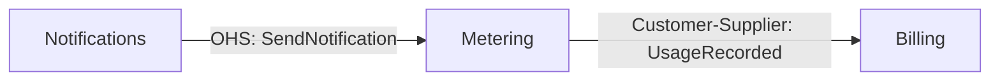

# Context Map

The tables are the source of truth. The diagram is generated from them; do not edit it by hand.

## Contexts

| Context | Purpose | Classification | Code location | Glossary |
|---|---|---|---|---|
| Metering | Counts Metered_Events and checks them against the Quota | core | `com.example.metering` | [glossary](metering/glossary.md) |
| Billing | Turns usage into Invoices at the end of each Billing_Period | supporting | `com.example.billing` | [glossary](billing/glossary.md) |
| Notifications | Sends emails to Account_Owners from named templates | generic | `com.example.notifications` | |

## Relationships

| Upstream | Downstream | Pattern | Messages | Status | Since |
|---|---|---|---|---|---|
| Metering | Billing | Customer-Supplier | `UsageRecorded` (event) | agreed | import |
| Notifications | Metering | Open Host Service | `SendNotification` (command) | agreed | import |

## Diagram

