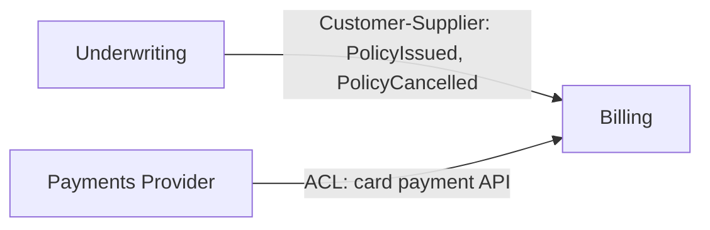

# Domain artefact formats

The formats every `sdd:domain-*` skill reads and writes. `sdd:domain-maintenance` and its `term_scan.py` script parse these files, so keep the headings, bold labels and table columns exactly as shown.

Each domain skill ships an identical copy of this file in its own `references/`, so that each skill works when it is installed alone. Edit the copy in `domain-define` and copy it to the other two; `tests/domain-formats/test_formats_in_sync.py` fails when the copies differ.

## Layout

A project with one bounded context, which is most services:

```
project/domain/
├── glossary.md
└── CHANGELOG.md
```

A project with two or more bounded contexts:

```
project/domain/
├── README.md          # index: contexts, owners, how to change a term
├── context-map.md     # contexts and the relationships between them
├── CHANGELOG.md       # dated, work-item-linked decisions
└── <context>/
    ├── glossary.md
    └── canvas.md      # written by sdd:domain-map, or on request
```

`<context>` is the context name in kebab case, such as `underwriting`. Create each file only when there is something to write in it.

## glossary.md

```markdown
# Glossary: Underwriting

Terms of the Underwriting context. One term per concept. Definitions say what the thing is in the business, not how it is stored.

## Terms

### Policy

A contract between the insurer and a Policyholder that covers named risks for a fixed term.

- **Avoid:** Contract, Cover
- **Status:** agreed
- **Since:** work-item 03
- **Code:** `com.acme.underwriting.policy.Policy`

### Policyholder

The person or organisation that holds a Policy and is entitled to claim under it.

- **Avoid:** Client, Insured
- **Status:** proposed
- **Since:** work-item 07

### Quote

~~A price offered for a Policy before it is issued.~~ Use Offer.

- **Status:** deprecated *(deprecated, see work-item 09)*
- **Since:** work-item 02
```

Rules:

- The heading is the canonical term, written in the form the project's specs use for subjects. sdd-skills specs write multi-word terms with underscores (`Usage_Digest`, `Account_Owner`), so that is the default; a project that writes `Usage Digest` keeps spaces. Never use code casing such as `UsageDigest` in a heading. Matching ignores case, spaces, underscores, hyphens and code casing, so `Usage_Digest`, `Usage Digest`, `UsageDigest` and `usage-digest` are the same term.
- The definition is one or two sentences and states what the thing **is**. It names no table, class, endpoint or framework.
- `Avoid:` lists the words people use for the same concept that the team has decided not to use. A word appears in at most one `Avoid:` list per glossary, and never as the heading of a proposed or agreed term in the same glossary. The one exception is a rename in progress: the old term keeps its entry, and its name is in the new term's `Avoid:` list, until `sdd:domain-maintenance` deprecates it.
- `Status:` is one of `proposed`, `agreed` or `deprecated`. A deprecated term keeps its entry, so the decision stays readable, and carries a `*(deprecated, see work-item NN)*` annotation, the grammar `sdd:spec-maintenance` uses.
- `Since:` is `work-item NN`, `import` for a term brought in from an older glossary, or `domain-map YYYY-MM-DD` for a term proposed while mapping.
- `Code:` is optional: the fully qualified name, package or module where the term lives in code. Add it only when it is already true.
- Keep entries in alphabetical order inside `## Terms`.

## context-map.md

````markdown
# Context Map

The tables are the source of truth. The diagram is generated from them; do not edit it by hand.

## Contexts

| Context | Purpose | Classification | Code location | Glossary |
|---|---|---|---|---|
| Underwriting | Decides whether to offer cover and on what terms | core | `com.acme.underwriting` | [glossary](underwriting/glossary.md) |
| Billing | Collects premiums and refunds | supporting | `com.acme.billing` | [glossary](billing/glossary.md) |

## Relationships

| Upstream | Downstream | Pattern | Messages | Status | Since |
|---|---|---|---|---|---|
| Underwriting | Billing | Customer-Supplier | `PolicyIssued` (event), `PolicyCancelled` (event) | agreed | work-item 03 |
| Payments Provider | Billing | Anticorruption Layer | card payment API (call) | proposed | work-item 07 |

## Diagram


````

Rules:

- `Classification` is `core`, `supporting` or `generic`. It decides how much modelling a context deserves: core gets the care, generic gets bought or kept thin.
- `Code location` is a package prefix, module path or service name. `sdd:domain-maintenance` uses it to check dependencies between contexts. Leave it empty for an external system.
- The downstream context depends on the upstream one. A row allows the downstream code to depend on the upstream code. `Shared Kernel` and `Partnership` allow both directions.
- `Pattern` is one of the names in `sdd:domain-map`'s `references/context-map-patterns.md`.
- `Messages` lists what crosses the boundary, each marked `(event)`, `(command)`, `(query)` or `(call)`.
- `Status` and `Since` follow the glossary rules.
- Regenerate the diagram whenever a row changes.

## canvas.md

A trimmed Bounded Context Canvas. Write one only for a core context, or when the user asks.

```markdown
# Canvas: Underwriting

**Classification:** core
**Owner:** {team}

## Purpose
{one or two sentences: what the context is for, in business terms}

## Inbound messages
| Message | Kind | From |
|---|---|---|

## Outbound messages
| Message | Kind | To |
|---|---|---|

## Business decisions
- {a rule the context owns, such as "refuse cover above the risk appetite"}

## Assumptions and open questions
- {each with who can answer it}
```

## CHANGELOG.md

Newest entry first. One entry per work item or per mapping session. Every line says what changed and, for a choice between words, why.

```markdown
# Domain Changelog

## 2026-11-18, work-item 07

- Proposed **Policyholder** (Underwriting). Chosen over Client and Customer, because Billing already uses Customer for the paying party. Avoid: Client, Insured.
- Proposed relationship Payments Provider → Billing, Anticorruption Layer.

## 2026-11-20, work-item 07, maintenance

- Agreed **Policyholder** (Underwriting).
- Agreed relationship Payments Provider → Billing.
```

A rename is two lines: the new term proposed, and the old term marked for deprecation with a pointer to the new one. `sdd:domain-maintenance` applies the deprecation when the work item finishes.
