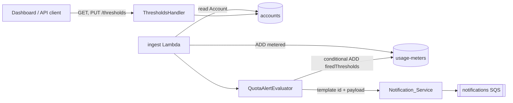

# Design Document: Quota Alerts

## Overview

Account_Owners are emailed when usage crosses an Alert_Threshold. The ingest Lambda evaluates thresholds straight after its atomic increment of the Usage_Meter, records which thresholds have fired on the same `usage-meters` item, and hands the email to the existing Notification_Service. Thresholds are stored on the `accounts` item and managed through a new `thresholds` sub-resource beside `plan`.

## Key Design Decisions

- **Evaluate on the ingest increment.** The atomic `ADD` on `metered` returns the new count, so evaluation needs no extra read of usage and runs once per increment (Requirement 2.1).
- **Reuse the ingest Lambda's account read.** The ingest Lambda already loads the Account item to authenticate the API key. The evaluator takes `plan`, `status` and `thresholds` from that item, so a plan change or a lowered threshold is seen on the next increment and no new table access is added (Requirements 4.1, 4.2). The Quota_Cache is not used on this path.
- **Fired state on the usage-meters item.** A `firedThresholds` number set sits beside `metered`. Each billing period has its own item, so the state resets with the Billing_Period without a cleanup job (Requirement 2.3).
- **Delivery through Notification_Service.** The evaluator passes the template id `quota-threshold` and a payload map; the existing queue and rendering Lambda do the rest (Requirement 5).

## Architecture



## Components and Interfaces

```kotlin
class ThresholdsHandler(private val thresholds: ThresholdService) : HttpHandler {
    override fun invoke(request: Request): Response = when (request.method) {
        Method.GET -> thresholds.read(request.accountId())
        Method.PUT -> thresholds.replace(request.accountId(), request.body())
        else -> Response(Status.METHOD_NOT_ALLOWED)
    }
}

class ThresholdService(private val accounts: AccountRepository) {
    fun read(accountId: String): Response
    fun replace(accountId: String, body: ThresholdSetRequest): Response
}

class QuotaAlertEvaluator(
    private val meters: UsageMeterRepository,
    private val notifications: NotificationService,
) {
    fun evaluate(account: Account, billingPeriod: String, metered: Long)
}
```

`ThresholdsHandler` lives in `api/handlers/`, `ThresholdService` and `QuotaAlertEvaluator` in `service/`, and the repositories in `repository/`, following the existing handler, service, repository layout. The evaluator returns immediately when `account.status` is `suspended` (Requirements 3.1, 3.2). Otherwise it computes `metered * 100 / quota` and, for each Alert_Threshold at or below that percentage, issues a conditional `UpdateItem` adding the threshold to `firedThresholds` only when it is not already present. Only a successful conditional write calls `NotificationService.send("quota-threshold", payload)`, which gives at most one alert per threshold per period (Requirements 2.2, 2.4).

## Data Models

`accounts` (existing, one new attribute):

| Attribute | Type | Notes |
|---|---|---|
| `accountId` | S | Partition key |
| `thresholds` | NS | Optional; absent means the default set `{80, 100}` |

`usage-meters` (existing, one new attribute):

| Attribute | Type | Notes |
|---|---|---|
| `accountId` | S | Partition key |
| `billingPeriod` | S | Sort key, `YYYY-MM` |
| `metered` | N | Running count, atomic increments |
| `firedThresholds` | NS | Thresholds that have fired in this period |

`quota-threshold` payload: `accountId`, `thresholdPercent`, `metered`, `quota`, `billingPeriod` (Requirement 5.2).

## Correctness Properties

- _For any_ replacement request, the stored Threshold_Set SHALL hold one to five distinct integers in 1..100, or the request SHALL be rejected with the stored set unchanged. **Validates: Requirements 1.2, 1.3**
- _For any_ Account without a stored set, reading the Threshold_Set SHALL return 80 and 100. **Validates: Requirements 1.1, 1.4**
- _For any_ sequence of increments within one Billing_Period, each Alert_Threshold SHALL produce at most one Quota_Alert. **Validates: Requirements 2.2, 2.4**
- _For any_ suspended Account, no Quota_Alert SHALL be sent and `firedThresholds` SHALL be unchanged. **Validates: Requirements 3.1, 3.2**
- _For any_ Plan change or lowered Alert_Threshold, no alert SHALL be sent before the next increment. **Validates: Requirements 4.1, 4.2**
- _For any_ Quota_Alert, the payload SHALL contain the five fields of the `quota-threshold` template. **Validates: Requirements 5.1, 5.2**

## Error Handling

| Condition | Status | `Problem.code` |
|---|---|---|
| Invalid Threshold_Set | 400 | `invalid-thresholds` |
| Unknown account | 404 | `account-not-found` |

A failed `NotificationService.send` after a successful conditional write is logged and does not fail the ingest call; the fired state is kept so the alert is not retried as a duplicate.

## API Specifications

`GET /accounts/{accountId}/thresholds`

- Response 200: `ThresholdSet` (`{ "thresholds": [80, 100] }`)
- Response 404: `Problem`

`PUT /accounts/{accountId}/thresholds`

- Request body: `ThresholdSet`
- Response 200: `ThresholdSet`
- Response 400: `Problem`
- Response 404: `Problem`

Both operations are added to `openapi.yaml`, with `ThresholdSet` as a new schema, and the Kotlin and TypeScript types are regenerated with `scripts/generate-api-types.sh`.

## Testing Strategy

- Unit tests for `ThresholdService` validation (count, duplicates, range, non-integer) and for `QuotaAlertEvaluator` (first crossing, repeat crossing, suspended Account, lowered threshold, plan change).
- Integration tests for the conditional `firedThresholds` write against DynamoDB Local.
- Contract test that the generated types match `openapi.yaml`; CI already fails on a diff.
- E2E: the Playwright mock-server suite covers the `thresholds` read and replace calls.
