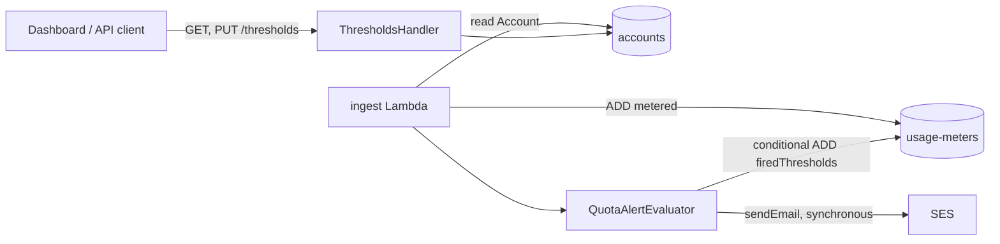

# Design Document: Quota Alerts

## Overview

Account_Owners are emailed when usage crosses an Alert_Threshold. The ingest Lambda evaluates thresholds straight after its atomic increment of the Usage_Meter, records which thresholds have fired on the same `usage-meters` item, and sends the email itself with the AWS SES client, rendering the `quota-threshold` HTML in the ingest Lambda so that the Account_Owner is told as soon as the increment lands. Thresholds are stored on the `accounts` item and managed through a new `thresholds` sub-resource beside `plan`.

## Key Design Decisions

- **Evaluate on the ingest increment.** The atomic `ADD` on `metered` returns the new count, so evaluation needs no extra read of usage and runs once per increment (Requirement 2.1).
- **Reuse the ingest Lambda's account read.** The ingest Lambda already loads the Account item to authenticate the API key. The evaluator takes `plan`, `status` and `thresholds` from that item, so a plan change or a lowered threshold is seen on the next increment and no new table access is added (Requirements 4.1, 4.2). The Quota_Cache is not used on this path.
- **Fired state on the usage-meters item.** A `firedThresholds` number set sits beside `metered`. Each billing period has its own item, so the state resets with the Billing_Period without a cleanup job (Requirement 2.3).
- **Send directly from the ingest Lambda.** Going through the notifications queue adds a hop and a delay before the Account_Owner hears about the crossing. The evaluator renders the email body itself and calls `SesClient.sendEmail` synchronously before the ingest call returns (Requirement 5).

## Architecture



## Components and Interfaces

```kotlin
class ThresholdsHandler(private val thresholds: ThresholdService) : HttpHandler {
    override fun invoke(request: Request): Response = when (request.method) {
        Method.GET -> ok(thresholds.read(request.accountId()))
        Method.PUT -> ok(thresholds.replace(request.accountId(), request.body()))
        else -> Response(Status.METHOD_NOT_ALLOWED)
    }
}

class ThresholdService(private val accounts: AccountRepository) {
    fun read(accountId: String): ThresholdSet
    fun replace(accountId: String, body: ThresholdSet): ThresholdSet
}

class QuotaAlertEvaluator(
    private val meters: UsageMeterRepository,
    private val ses: SesClient,
    private val renderer: QuotaAlertRenderer,
) {
    fun evaluate(account: Account, billingPeriod: String, metered: Long, firedThresholds: Set<Int>)
}
```

`ThresholdsHandler` lives in `api/handlers/`, `ThresholdService` and `QuotaAlertEvaluator` in `service/`, and the repositories in `repository/`, following the existing handler, service, repository layout. The evaluator returns immediately when `account.status` is `suspended` (Requirements 3.1, 3.2). Otherwise it computes `metered * 100 / quota` in integer arithmetic, which rounds down, so a threshold fires only when usage has fully reached it, and, for each Alert_Threshold at or below that percentage, issues a conditional `UpdateItem` adding the threshold to `firedThresholds` with the condition `attribute_not_exists(firedThresholds) OR NOT contains(firedThresholds, :threshold)`. Only a successful conditional write renders the alert and calls `ses.sendEmail(...)`, which gives at most one alert per threshold per period (Requirements 2.2, 2.4). The ingest `ADD` now asks for `ReturnValues: ALL_NEW`, at no extra read, so the evaluator skips every threshold that is in the returned `firedThresholds` and writes only for the others. A `ConditionalCheckFailedException` means a concurrent increment fired that threshold first, so the evaluator sends nothing for it and the ingest call succeeds. Any other error on that write is logged and does not fail the ingest call; the threshold stays unfired, so the next increment at or above it tries again.

`ThresholdService` throws `InvalidThresholds` and `AccountNotFound`, which the handler maps to the 400 and 404 `Problem` responses, as the `plan` handler does. `ThresholdService.replace` validates the whole set before it writes, so a rejected request writes nothing. An Account without a stored `thresholds` attribute is evaluated against the default set `{80, 100}` (Requirement 1.1).

The evaluator maps `plan` to its Quota with the existing `Plan.quota` values (`starter` 10,000, `team` 250,000, `scale` 2,000,000), the same mapping the usage Lambda caches. When one increment crosses more than one Alert_Threshold, each crossed threshold gets its own conditional write and its own Quota_Alert.

Replacing the Threshold_Set leaves `firedThresholds` as it is: a value that stays in the set keeps its fired state for the Billing_Period, and a new or lowered value fires on the next increment that reaches it (Requirement 4.2).

## Data Models

`accounts` (existing, one new attribute):

| Attribute | Type | Notes |
|---|---|---|
| `accountId` | S | Partition key |
| `thresholds` | NS | Optional; absent means the default set `{80, 100}` |

`usage-meters` (existing, one new attribute):

| Attribute | Type | Notes |
|---|---|---|
| `accountId` | S | Partition key |
| `billingPeriod` | S | Sort key, `YYYY-MM` |
| `metered` | N | Running count, atomic increments |
| `firedThresholds` | NS | Thresholds that have fired in this period |

`quota-threshold` email values: `accountId`, `thresholdPercent`, `metered`, `quota`, `billingPeriod` (Requirement 5.2).

The `quota-threshold` HTML template is bundled with the ingest Lambda.

## Correctness Properties

- _For any_ replacement request, the stored Threshold_Set SHALL hold one to five distinct integers in 1..100, or the request SHALL be rejected with the stored set unchanged. **Validates: Requirements 1.2, 1.3**
- _For any_ Account without a stored set, reading the Threshold_Set SHALL return 80 and 100. **Validates: Requirements 1.1, 1.4**
- _For any_ sequence of increments within one Billing_Period, each Alert_Threshold SHALL produce at most one Quota_Alert. **Validates: Requirements 2.2, 2.4**
- _For any_ suspended Account, no Quota_Alert SHALL be sent and `firedThresholds` SHALL be unchanged. **Validates: Requirements 3.1, 3.2**
- _For any_ Plan change or lowered Alert_Threshold, no alert SHALL be sent before the next increment. **Validates: Requirements 4.1, 4.2**
- _For any_ Quota_Alert, the rendered email SHALL contain the five fields of the `quota-threshold` template. **Validates: Requirements 5.1, 5.2**

## Error Handling

| Condition | Status | `Problem.code` |
|---|---|---|
| Invalid Threshold_Set | 400 | `invalid-thresholds` |
| Unknown account | 404 | `account-not-found` |

A failed `SesClient.sendEmail` after a successful conditional write does not fail the ingest call and is not retried. The threshold stays in `firedThresholds`, and the evaluator logs the account id, threshold and error at ERROR level (Requirement 2.2).

## API Specifications

`GET /accounts/{accountId}/thresholds` (`operationId: getThresholds`)

- Response 200: `ThresholdSet` (`{ "thresholds": [80, 100] }`)
- Response 404: `Problem`

`PUT /accounts/{accountId}/thresholds` (`operationId: replaceThresholds`)

- Request body (required): `ThresholdSet`
- Response 200: `ThresholdSet`
- Response 400: `Problem`
- Response 404: `Problem`

Like `plan`, both operations sit under `/accounts/{accountId}`, take the shared `AccountId` parameter and use the shared `BadRequest` and `NotFound` responses (Requirement 1.5). Unlike `PUT /plan`, which returns the Account, `PUT /thresholds` returns the `ThresholdSet`, because the `Account` schema does not carry thresholds and Requirement 1.4 reads the set on its own.

```yaml
ThresholdSet:
  type: object
  required: [thresholds]
  properties:
    thresholds:
      type: array
      items:
        type: integer
        minimum: 1
        maximum: 100
      minItems: 1
      maxItems: 5
      uniqueItems: true
```

Reads return the values sorted ascending; a number set has no order of its own.

Both operations are added to `openapi.yaml`, with `ThresholdSet` as a new schema and `info.version` moved to 1.5.0, and the Kotlin and TypeScript types are regenerated with `scripts/generate-api-types.sh`.

## Testing Strategy

- Unit tests for `ThresholdService` validation (count, duplicates, range, non-integer, and the stored set unchanged after a rejection) and for `QuotaAlertEvaluator` (first crossing, repeat crossing, suspended Account, lowered threshold, plan change).
- Integration tests for the conditional `firedThresholds` write against DynamoDB Local, including the first alert of a Billing_Period, a new period's item, a failed send that leaves the threshold fired, and two concurrent increments that cross the same threshold and send one Quota_Alert, and for the SES call against a stubbed client.
- Unit tests for the default Threshold_Set read, two thresholds crossed by one increment, the `quota-threshold` payload fields, and the 404 for an unknown Account on both operations.
- Contract test that the generated types match `openapi.yaml`; CI already fails on a diff.
- E2E: the Playwright mock-server suite covers the `thresholds` read and replace calls.
