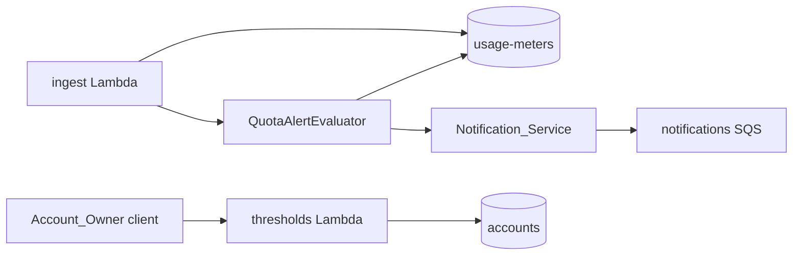

# Design Document: Quota Alerts

## Overview

Quota alerts are evaluated on the ingest path. After the ingest Lambda increments the `usage-meters` item it passes the returned `metered` value and `fired` set to `QuotaAlertEvaluator`, which compares the new usage percentage against the Account's Threshold_Set and publishes one `quota-threshold` message per newly crossed Alert_Threshold through the Notification_Service. The Threshold_Set is read and replaced through a new `thresholds` sub-resource that follows the existing `plan` sub-resource.

## Key Design Decisions

- **Evaluate from the increment result.** The atomic increment returns the new `metered` value, so evaluation needs no extra DynamoDB read.
- **Fired state on the usage-meters item.** A `fired` number set on the item resets with the Billing_Period because the sort key changes.
- **Conditional write for fired state.** The evaluator adds a threshold to `fired` with a condition that it is not already present, so two concurrent increments cannot both send the alert.
- **Thresholds on the accounts item.** A `thresholds` number set on the `accounts` item, defaulting to 80 and 100 when absent.

## Architecture



## Components and Interfaces

```kotlin
class ThresholdSet private constructor(val values: Set<Int>) {
    companion object {
        val DEFAULT = ThresholdSet(setOf(80, 100))
        fun of(raw: List<Any>): Result<ThresholdSet>
    }
}

class QuotaAlertEvaluator(
    private val quotas: QuotaLookup,
    private val meters: UsageMeterRepository,
    private val notifications: NotificationService,
) {
    fun evaluate(account: Account, meter: UsageMeter)
}

class ThresholdHandler(private val accounts: AccountRepository) {
    fun get(request: Request): Response
    fun replace(request: Request): Response
}
```

`GET` and `PUT /accounts/{accountId}/thresholds` return and accept `{"thresholds": [80, 100]}`. Errors use the existing `Problem` body: 400 `threshold-set-invalid` and 404 for an unknown Account.

## Data Models

| Table | Attribute | Type | Notes |
|---|---|---|---|
| `accounts` | `thresholds` | NS | Optional, defaults to 80 and 100 |
| `usage-meters` | `fired` | NS | Alert_Threshold values already alerted in this Billing_Period |

The `quota-threshold` payload carries `accountId`, `threshold`, `metered`, `quota` and `billingPeriod`.

## Correctness Properties

- _For any_ Threshold_Set and any sequence of increments in one Billing_Period, each Alert_Threshold SHALL produce at most one Quota_Alert. **Validates: Requirements 2.2, 2.4**
- _For any_ list that is not one to five distinct integers between 1 and 100, `ThresholdSet.of` SHALL fail. **Validates: Requirements 1.3**

## Error Handling

| Condition | Status | `Problem.code` |
|---|---|---|
| Invalid threshold list | 400 | `threshold-set-invalid` |
| Unknown account | 404 | `account-not-found` |
| Notification publish fails | none | evaluator logs and leaves the threshold out of `fired` so the next increment retries |

## Testing Strategy

- Unit tests for `ThresholdSet` and `QuotaAlertEvaluator`.
- Integration tests for the `thresholds` handler and the fired-state write against DynamoDB Local.
- Playwright check through the mock server for reading and replacing thresholds.
